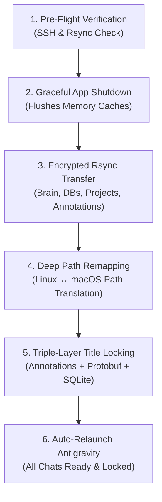

# Antigravity Sync (Cross-Platform)

A machine-agnostic synchronization utility for **Google Antigravity (AGY)** conversations, workspaces, and history databases across macOS and Linux.

---

## 🌟 The Essence & Purpose of This Project

### The Problem: Cloud Account Quota, Isolated Local Silos
When you use Google Antigravity across multiple machines (for instance, a Linux workstation at the office or lab, and a MacBook on the go), both installations often share the same Google account. They share the same Gemini API quota, models, and token limits in the cloud.

However, **Google Antigravity does not synchronize conversation history, agent trajectories, or workspaces across devices.**

Each Antigravity installation operates as an isolated local silo on that specific machine's hard drive (`~/.gemini/antigravity/`):
* The rich conversation transcripts, agent planning steps, and code artifacts you spent hours generating on your Linux system stay trapped on that Linux machine.
* When you open Antigravity on your Mac, your history is completely blank regarding your Linux work—you cannot view past solutions, reference previous tool calls, or resume where you left off.
* Even if you manually copy files, Antigravity's internal backend rejects them or resets custom titles because the absolute paths (`/home/user` vs `/Users/user`) mismatch and internal Protobuf metadata breaks.

### The Solution
`antigravity-sync` bridges this gap. It turns independent Antigravity installations into a unified, portable workflow. With a single command, it securely connects to your remote machine, pulls your conversations, translates filesystem paths, synchronizes custom chat titles across all internal layers, and makes your entire history instantly accessible on your local desktop.

---

## 🗺️ The Sync Journey: How It Works Under the Hood

The synchronization process runs in five carefully orchestrated phases:



### Phase 1: Pre-Flight Health Checks & Graceful Shutdown
1. **Connectivity Probe**: The engine verifies network reachability, SSH keys, and remote `rsync` availability. It dynamically queries the remote system (`echo $HOME`) to detect the remote user directory on the fly.
2. **Process Flush**: Antigravity caches active chat titles and workspace metadata in RAM. If files are copied while the app or its background `language_server` is running, data can be corrupted or overwritten when the app closes.
   - On **macOS**, it sends an AppleScript quit event and waits until all worker threads exit.
   - On **Linux**, it issues a graceful `SIGTERM` and confirms process termination.

### Phase 2: What Is Transferred (Component Sync)
The engine transfers the five core components of Antigravity's storage architecture over an encrypted SSH tunnel:
* **The Brain (`brain/<uuid>/`)**: The complete trajectory logs (`transcript.jsonl`), step execution trees, agent thoughts, and generated Markdown artifacts.
* **Conversation Databases (`conversations/<uuid>.db`)**: SQLite databases containing step-by-step turn records, execution statuses, and internal trajectory metadata.
* **Project Configurations (`config/projects/*.json`)**: Workspace registry mapping project folders and IDE configurations.
* **Chat Annotations (`annotations/<uuid>.pbtxt`)**: The master store of user customizations—including custom chat names and interaction timestamps in Google Protobuf text format.
* **The Sidebar Index (`agyhub_summaries_proto.pb`)**: Transferred to a temporary staging buffer (`/tmp/remote_staging_proto.pb`) so that remote conversations can be merged without wiping existing local chats.

### Phase 3: Deep Cross-Platform Path Remapping
Because Antigravity binds workspaces to absolute URIs (e.g. `file:///home/qnu/Projects/...`), running imported chats on macOS (`/Users/miradeem/...`) causes the backend to fail.
The engine dynamically scans and translates all absolute paths:
* In all transcript logs (`transcript*.jsonl`).
* In all project workspace definitions (`projects/*.json`).
* Inside the binary `trajectory_metadata_blob` within every individual `conversations/<uuid>.db` SQLite database using a custom Protobuf byte-level remapper.

### Phase 4: Triple-Layer Title Locking (The Title Reversion Solution)
A common issue when transferring Antigravity chats is that while titles appear initially in the sidebar, clicking any chat causes Antigravity's internal reconciler to reset the title to the raw first prompt line.

`antigravity-sync` solves this by synchronizing titles across all three internal layers simultaneously:
1. **Layer 1: Chat Annotations (`annotations/<uuid>.pbtxt`)**: Writes the authoritative `title:"[Remote] ..."` entry. When Antigravity opens a chat, its `annotationsProvider` reads this file and confirms the user explicitly named the chat, permanently preventing fallback summarization.
2. **Layer 2: Sidebar Index (`agyhub_summaries_proto.pb`)**: Merges the remote chats into the local index in-memory (preserving 100% of your local native chats) with the configured tag prefix (e.g. `[Remote] ` or `[Linux] `).
3. **Layer 3: SQLite Summaries (`conversation_summaries.db`)**: Updates the cached `title` column and patches `workspace_uris`.

### Phase 5: Relaunch
Antigravity is automatically reopened (`open -a Antigravity` or `gtk-launch antigravity`). All remote chats appear in the sidebar with your custom tags, ready to open, search, and resume.

---

## 🚀 Setup & Usage

### 1. Requirements
* **Python 3.8+** (Uses standard library only—**zero external pip dependencies**).
* `ssh` and `rsync` installed on both local and remote machines.

### 2. Configuration
Copy `sync.conf.example` to `sync.conf`:
```bash
cp sync.conf.example sync.conf
```

Edit `sync.conf` with your remote machine credentials:
```bash
# Remote host IP address or hostname
REMOTE_HOST="192.168.1.50"

# Remote username on the target machine
REMOTE_USER="username"

# Remote SSH Port (default: 22)
REMOTE_PORT="22"

# Optional: Path to custom SSH Identity file
SSH_KEY=""

# Sidebar Chat Tagging (prepends tag to imported chats)
SYNC_TAG_PREFIX="[Remote] "
SYNC_TAG_SUFFIX=""
```

### 3. Run the Sync
```bash
# Using the shell wrapper
./sync.sh pull

# Or directly with Python
python3 agy_sync.py pull
```

---

## 🔒 Privacy & Security Note
* `sync.conf` is included in `.gitignore` by default so your private IP addresses and usernames will never be accidentally committed to source control.
* All data transfers occur over your existing encrypted SSH tunnel (`rsync -e ssh`). No third-party servers, telemetry, or external APIs are used.

---

## 📄 License
MIT License. Open-source and free for personal and professional use.
